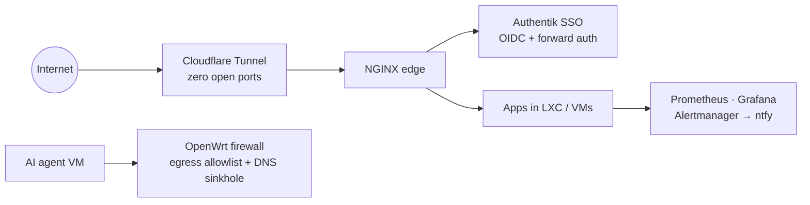

<h1 align="center">Hi, I'm Josef 👋</h1>

  CS student at <b>Masaryk University</b> (FI, Brno) 
  I like infrastructure that runs itself: automated, monitored and locked down.

  
  
  

---

### 🏠 Homelab: my main project

One Proxmox server, everything defined as code. Rebuilding it from scratch is a single Ansible run.

- **8 LXC containers / VMs**, provisioned by **21 custom Ansible roles** (Vault for secrets, idempotent reruns)
- **No open ports**: Cloudflare Tunnel → NGINX, every service behind central SSO
- **Monitoring and alerting** with Prometheus, Grafana, Alertmanager and Uptime Kuma, plus nightly backups
- **Sandboxed AI coding agent** in an isolated VM with SNI-based egress allowlist and DNS sinkhole
- Scale-to-zero apps and defense in depth (per-host firewalls, unprivileged containers, Docker socket proxy)

### 🚀 Other projects

| Project | What it is |
|---|---|
| **[health-coach](https://github.com/diamond447/health-coach)** | Self-hosted MCP servers that let an AI assistant coach me from my own health and training data. Runs daily in the homelab behind Authentik. |
| **[mapy-gpx-exporter](https://github.com/diamond447/mapy-gpx-exporter)** | Python library + CLI for exporting GPX from Mapy.com, [published on PyPI](https://pypi.org/project/mapy-gpx-exporter/). Reverse-engineered the export flow from browser devtools. |
| **[BikeMapy](https://github.com/diamond447/BikeMapy)** | Map of cycling routes shared on BikeForum.cz. An experiment in spec-driven development: I write specs and review PRs, AI agents write the code. |

> 🤖 **About AI:** I build my app projects with AI coding agents. I design the system, write the spec,
> review every change and own the infrastructure it runs on. The homelab is my own hands-on work.
> 🧩 **Without AI:** I learned to code by solving algorithmic problems by hand in
> [KSI](https://ksi.fi.muni.cz/profil/5468), the Correspondence Seminar in Informatics at Masaryk University,
> which I completed as a successful graduate in the 2024/2025 year.

### 🛠️ Tools I actually use

### 🌱 Right now

- 2nd year of Bc. *Programming and Application Development* at FI MUNI
- 4th year of using Manjaro btw 
- Other hobbies: fitness, cycling, martial arts, bouldering 🚴
